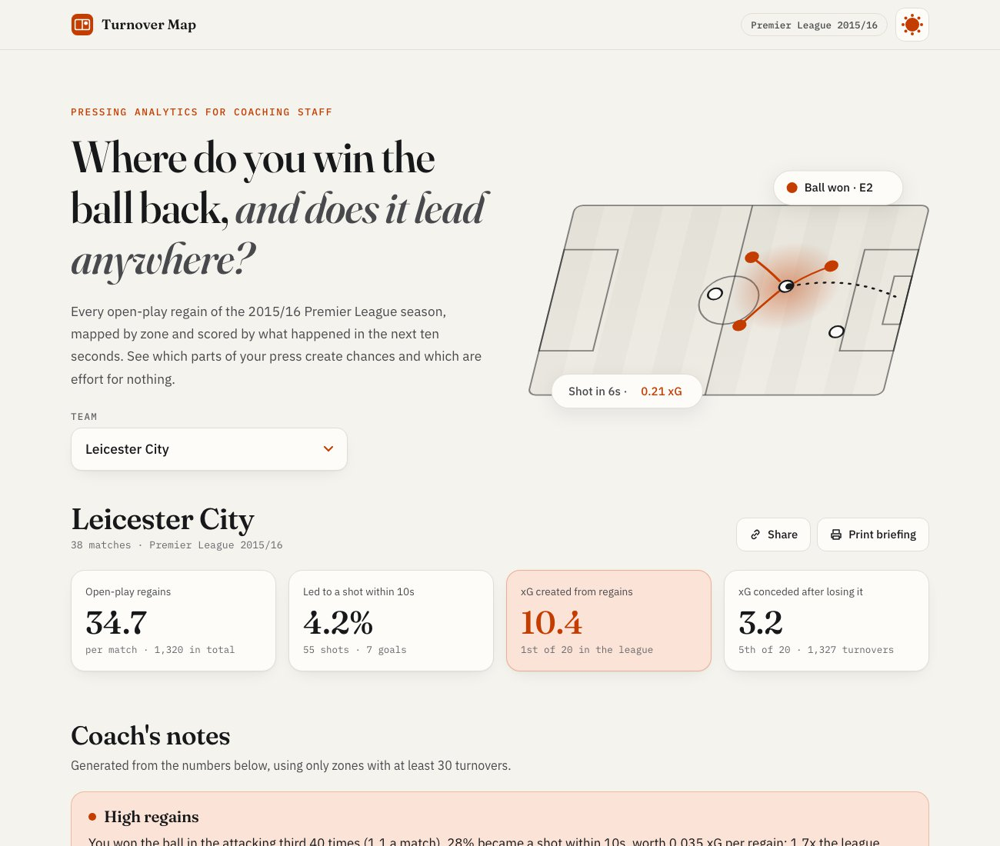
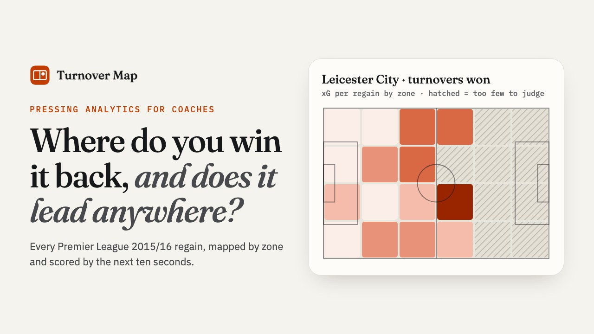
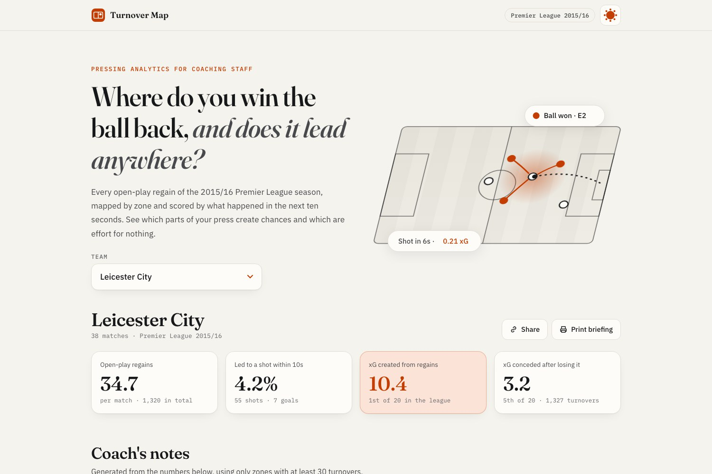
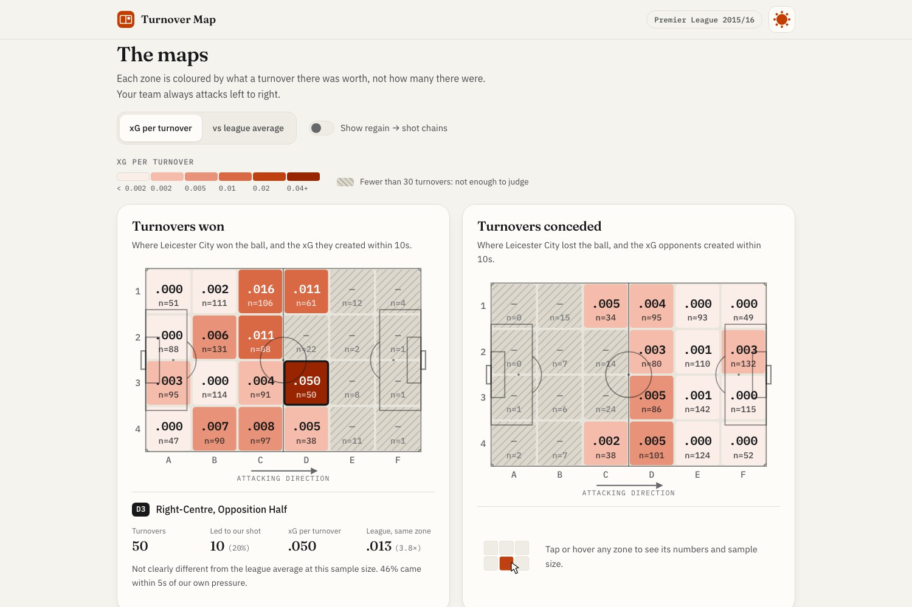
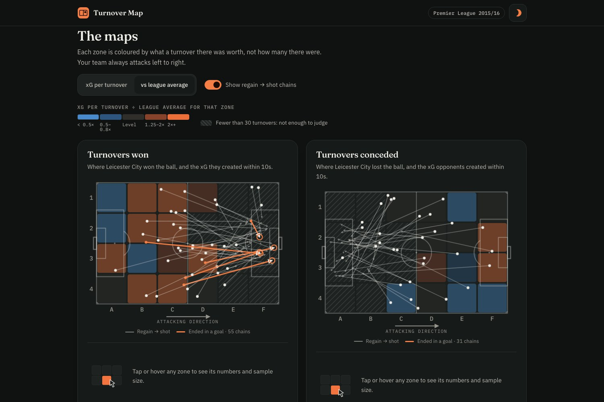
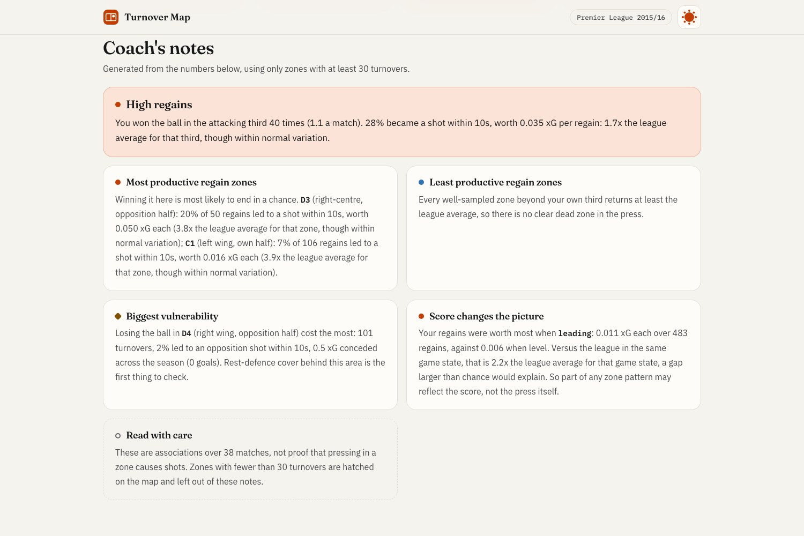
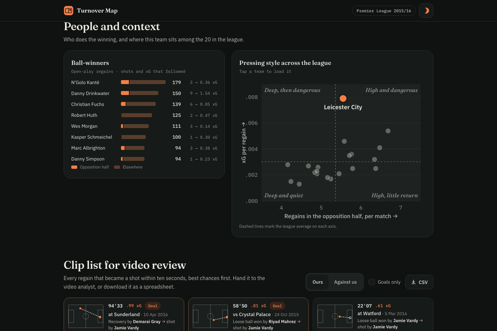
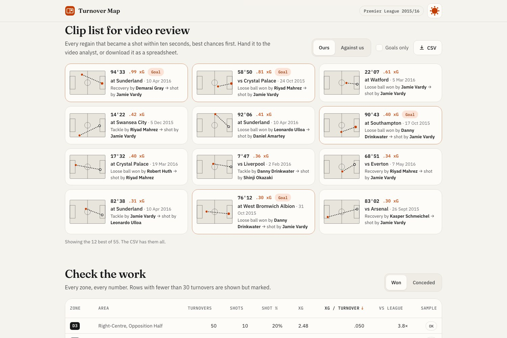
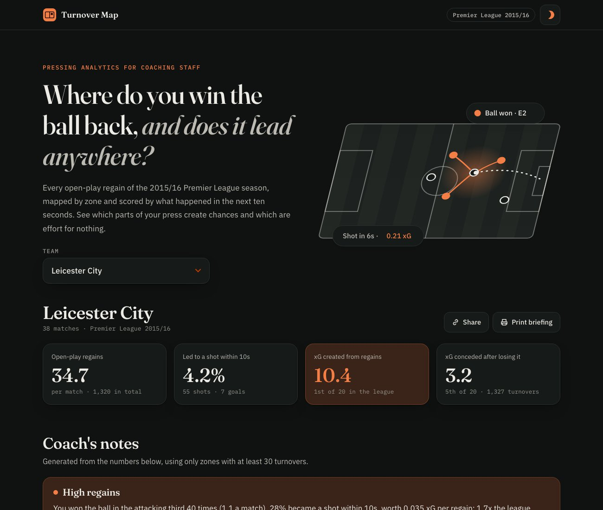
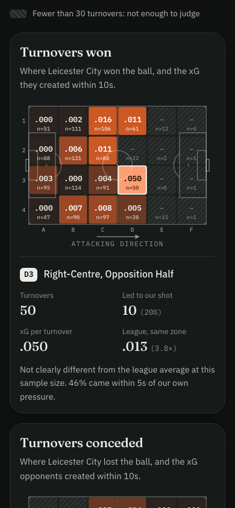

# Turnover Map

**Live demo: [https://turnover-map.pages.dev](https://turnover-map.pages.dev)**

**Demo video (2 min): [https://youtu.be/8P1POpOLhLE](https://youtu.be/8P1POpOLhLE)**

Pressing and turnover analytics for football coaching staff. Pick a team and see where on the pitch it wins the ball back, which of those regains lead to a shot within ten seconds, and where losing the ball hurts most.

Built for the AQX Sports Analytics Data Bowl 4.0 on [StatsBomb Open Data](https://github.com/statsbomb/open-data): Premier League 2015/16, all 380 matches, 26,715 open-play turnovers.



## Demo video

[](https://youtu.be/8P1POpOLhLE)

A two-minute narrated walkthrough: [https://youtu.be/8P1POpOLhLE](https://youtu.be/8P1POpOLhLE). Captions: [demo/turnover-map-demo.srt](demo/turnover-map-demo.srt).

| Time | Section |
|---|---|
| 0:00 | The problem |
| 0:10 | Picking a team |
| 0:22 | Coach's notes |
| 0:37 | The pitch maps |
| 0:49 | Zone detail |
| 0:58 | Compared with the league |
| 1:06 | Regain-to-shot chains |
| 1:13 | Does the score explain it? |
| 1:30 | Ball-winners and league context |
| 1:40 | Clip list for video review |
| 1:49 | Data and method |

## The problem

Every coach talks about pressing. Few can say which zones of their press produce chances and which are effort for nothing. Raw "ball recoveries by zone" maps are common, but they only show volume. They can't tell a regain that starts a counter from one that goes nowhere.

Turnover Map colours every zone by **what a turnover there was worth** (xG created within ten seconds per regain), compares it with what the rest of the league gets from the same zone, and shows the sample size everywhere so nobody mistakes four turnovers for a finding.

## Features

- **Pitch heatmaps, won and conceded.** 6×4 zones coloured by xG per turnover, or by ratio to the league average for that zone. Both maps use the team's own attacking direction, so the conceded map shows where *you* lose the ball.
- **Coach's notes.** Plain-English summary for each team: high regains, the two most productive zones, the two least productive, the biggest vulnerability, and how the score changes the picture. Only zones with at least 30 turnovers are used.
- **Regain → shot chains.** Toggle arrows from every regain to the shot that followed, with goals highlighted.
- **Clip list for video review.** Every regain that became a shot, best chances first: match, minute, who won it, who shot. Export to CSV for the video analyst.
- **Game-state split.** xG per regain when leading, level and trailing, each against the league in the same state. Teams that lead counter into space, so this is the first check before crediting the press.
- **By-third rollup.** Pools zones into thirds, which gives a usable sample high up the pitch where single zones rarely reach 30 regains.
- **Ball-winners.** Each team's top eight ball-winners, the share won in the opposition half, and the shots and xG that followed.
- **League pressing-style scatter.** All 20 teams: regains in the opposition half per match against xG per regain. Tap a dot to load that team.
- **Check the work.** A sortable table of every zone with turnovers, shots, xG, league comparison and a sample-size flag.
- **Print briefing and share link.** A clean print layout for staff meetings, and a URL per team.
- Light and dark mode (follows the system, with a toggle), phone-first layout, keyboard navigable.

## What a coach can do with it

- Decide where to set pressing triggers: zones where regains pay off are where the press is worth the running.
- Spot regains that go nowhere: zones where the team wins the ball often but creates less than the league does from the same spot point to a problem with the next action (first pass, support runners), not with the press.
- Plan rest-defence: the vulnerability note names the zone where losing the ball cost the most xG.
- Brief the video team: the clip list hands them every relevant sequence with a timestamp.

## Method

1. **Find the regain.** Every new StatsBomb possession that starts in open play (`Regular Play` or `From Counter`) straight after the opponent had the ball. The tackle, interception or recovery that won the ball is often logged a moment earlier, inside the opponent's possession, so the pipeline looks back up to 3 seconds for it and uses its location and type. Set pieces, restarts and keeper possessions are excluded.
2. **Start the clock.** Follow the same possession for 10 seconds. Any non-penalty shot by the regaining team in that window counts.
3. **Score it.** The regain's value is the StatsBomb xG of those shots, combined as `1 − Π(1 − xG)` (the chance at least one went in), so rebounds aren't double counted.
4. **Aggregate.** Per team and per 20×20 zone: turnovers, shots, shot rate, total xG, xG per turnover and standard error. The same is done for turnovers conceded, flipped into the team's frame.
5. **Compare.** Each zone is compared with the league average for that zone. A gap is called "clear" only when it exceeds about two standard errors.

### Statistical honesty

- **Association, not causation.** A zone where regains lead to shots shows a correlation. Game state, opponent quality and team shape all play a part. The page says so in the notes and the method section.
- **Sample sizes everywhere.** Zones with fewer than 30 turnovers are hatched on the map, marked "Low" in the table, sorted below well-sampled zones, and never used in the generated notes.
- **No overclaiming.** Most zone-level gaps don't clear the two-standard-error bar in a single season, and the notes say "within normal variation" when that's the case.

### Sanity checks

- Man City 1–3 Leicester (6 Feb 2016) parses to the correct scorers and minutes. None of the goals is counted as a regain goal, which is right: they came from set pieces and a sustained attack.
- Leicester's top regain-to-goal chains include Vardy's stoppage-time goal at Sunderland (10 Apr 2016), his winner against Crystal Palace (24 Oct 2015) and his late equaliser at Southampton (17 Oct 2015). All are real counter-attacking goals.
- N'Golo Kanté is Leicester's top ball-winner (179 open-play regains), and Leicester lead the league in xG from regains.

## Gallery

| | |
|---|---|
|  |  |
| Team overview and headline numbers | Heatmaps of turnovers won and conceded, with zone detail |
|  |  |
| League comparison with regain-to-shot chains (dark mode) | Plain-English coach's notes |
|  |  |
| Ball-winners and league pressing style (dark mode) | Clip list for video review |





## Architecture

All analysis runs offline in Python and writes one JSON file. The web app only reads that file: no analysis at runtime, no database, no API calls.

```
analysis/build.py      StatsBomb events → web/public/results.json
web/                   Vite + React + TypeScript single page, plain SVG pitch
web/public/results.json  precomputed results (committed)
```

## Run it locally

Requirements: Python 3.10+ with pandas, Node 20+.

```bash
git clone https://github.com/sja-thedude/Turnover-Map.git
cd Turnover-Map

# Web app (uses the committed results.json)
cd web
npm install
npm run dev        # http://localhost:5173
```

To rebuild the results from raw data, fetch only the Premier League 2015/16 files from StatsBomb Open Data (about 1.3 GB) and run the pipeline:

```bash
git clone --depth 1 --filter=blob:none --sparse https://github.com/statsbomb/open-data.git data/statsbomb
cd data/statsbomb
git sparse-checkout set --no-cone /data/competitions.json /data/matches/2/27.json
python3 -c "import json;[print(f'/data/{d}/{m[\"match_id\"]}.json') for m in json.load(open('data/matches/2/27.json')) for d in ('events','lineups')]" \
  | git sparse-checkout add --stdin
cd ../..

pip install -r analysis/requirements.txt
python3 analysis/build.py          # writes web/public/results.json (~20 s)
```

## Testing

```bash
python3 -m pytest analysis     # 36 tests: regain rules, 10s window, xG maths, game state, results.json invariants
cd web && npm run test:e2e      # 39 Playwright tests in Chrome, desktop and 390px phone
BASE_URL=https://turnover-map.pages.dev npm run test:e2e   # same suite against the live site
```

The Python suite checks each rule on synthetic event sequences (lookback for the winning tackle, shots inside and outside the window, penalties and set pieces excluded, rebounds combined as one chance) and checks the output: every turnover is counted once per side, the conceded maps mirror the won maps, and no generated note cites a low-sample zone. The browser suite covers every team, both colour modes, chains, zone detail, keyboard use, theme persistence, table sorting, CSV export, sharing, print layout, the loading and error states, phone layout (no horizontal scroll, 44px tap targets) and an axe accessibility scan in light and dark mode.

## Deploy

The site is static and deployed to Cloudflare Pages:

```bash
cd web && npm run build
npx wrangler pages deploy dist --project-name turnover-map --branch main
```

## Environment variables

None. The build and the app need no keys or secrets. Deployment uses your own `wrangler login` session. See `.env.example`.

## Stack

- Python 3, pandas: event parsing, possession chains, aggregation
- React 18, TypeScript, Vite: front end
- Plain SVG for the pitch, heatmaps, chains and scatter; no charting library
- Cloudflare Pages: hosting
- Fraunces, IBM Plex Sans and IBM Plex Mono (Google Fonts). All illustrations are original SVG.

## Data and credit

Data: [StatsBomb Open Data](https://github.com/statsbomb/open-data), used under the StatsBomb open data terms. Event data © StatsBomb. This project is not affiliated with StatsBomb, the Premier League or any club.

## Licence

[MIT](LICENSE)
